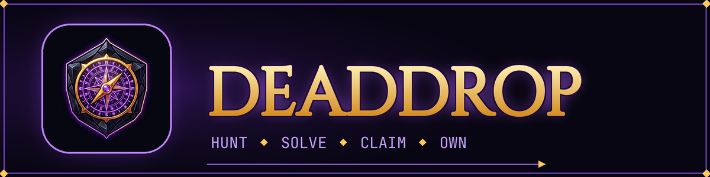
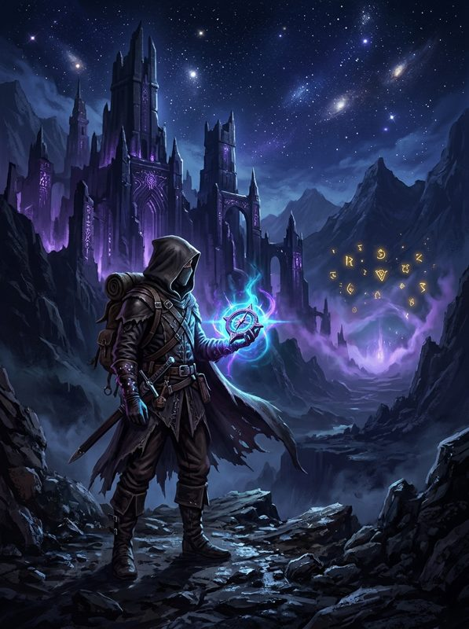
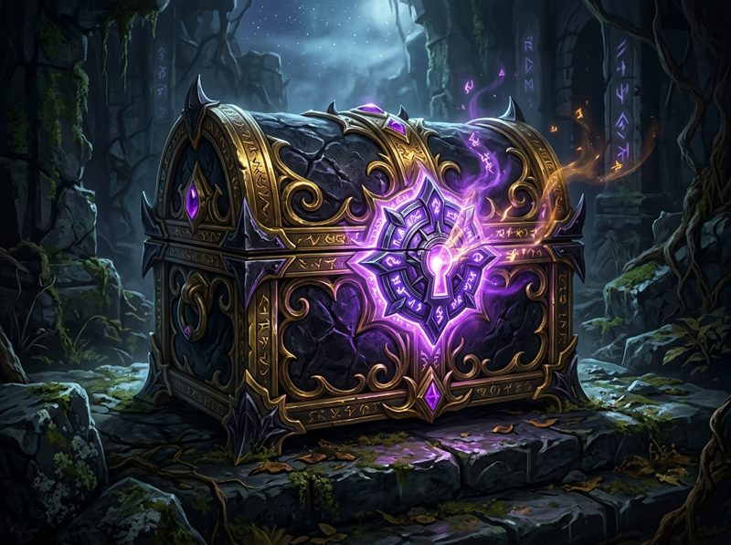
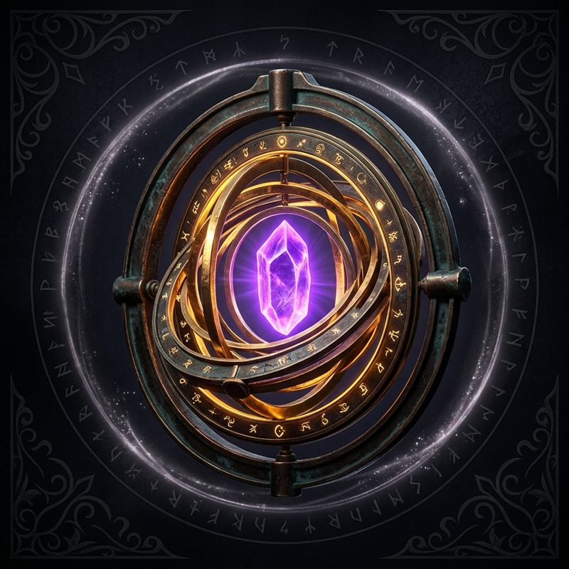
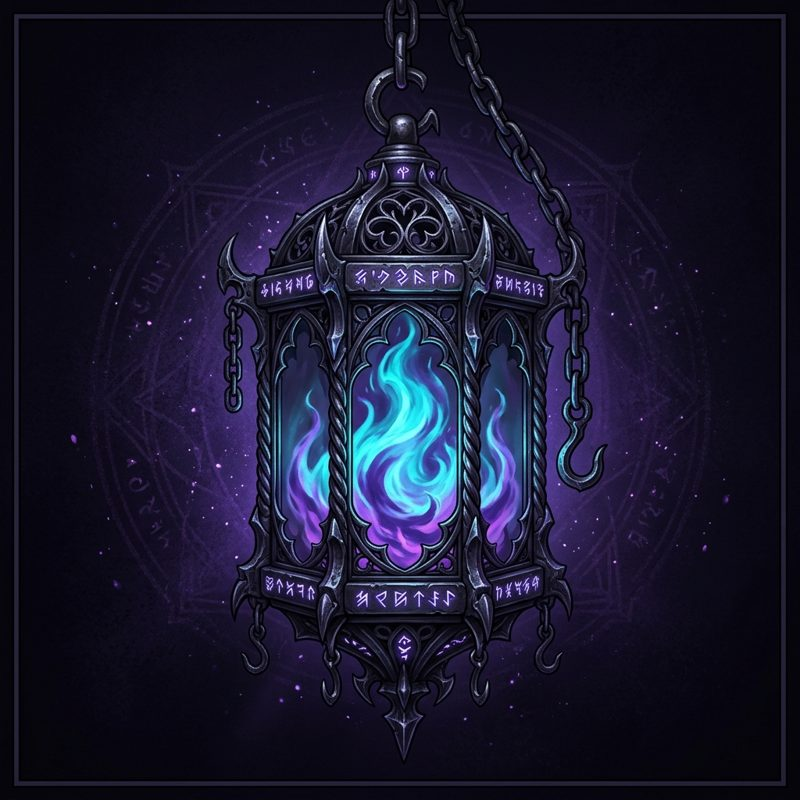

<div align="center">



**Hunt real-world treasures. Solve the challenge. Own the artifact.**

An Android app that turns real-world treasure hunting into a collectible, blockchain-ready experience: discover hidden treasures, solve challenges, unlock unique digital artifacts, and (on the roadmap) mint them as NFTs to collect, own and trade.




</div>

---

## 📖 About

DeadDrop is a dark-fantasy exploration game played in the real world. Treasures are hidden at real locations on a live map. You travel there, prove you found it with **GPS**, a **QR seal** or an **arcane cipher**, and claim a unique artifact for your vault. Players can also hide treasures of their own for others to find.

The long-term vision is for every artifact to be a verifiable, tradeable digital asset (an NFT) that players truly own.

> **Project status:** the game, maps, challenges, vault, profiles and a *simulated* exchange work today. On-chain minting and trading are **planned, not yet implemented** (see [Roadmap](#️-roadmap)). Right now, artifacts are in-app collectibles and trades use in-game Gold Coins.

---

## 🖼️ Gallery

<div align="center">
<table>
  <tr>
    <td align="center"><br/><sub><b>Obsidian Treasure</b><br/>hidden at a real-world location</sub></td>
    <td align="center"><br/><sub><b>Astrolabe</b><br/>collectible artifact</sub></td>
    <td align="center"><br/><sub><b>Spirit Lantern</b><br/>collectible artifact</sub></td>
  </tr>
</table>
</div>

<!-- Add real app screenshots here, e.g.:

-->

---

## ✨ Features

| | Feature | Description |
|---|---|---|
| 🗺️ | **Explore map** | Google Maps view of nearby treasures with live GPS. Falls back to an animated *Cartographic Radar* demo mode without a Maps key. |
| 🎯 | **Four challenge types** | GPS proximity · QR seal scan · Arcane cipher (puzzle answer) · Combined GPS + seal/cipher. |
| 💎 | **Vault** | Your collection of claimed artifacts, graded **Common, Rare, Epic, Mythic**. |
| 🛠️ | **Create treasures** | Place and publish your own treasure with a category, difficulty, rarity and challenge. |
| 🏪 | **Exchange** | Simulated marketplace: list and buy artifacts with in-game Gold Coins. |
| 👤 | **Profile** | Username, avatar, level, XP, gold, stats and an activity feed. |
| 🔐 | **Google Sign-In** | Firebase Auth via Credential Manager. |

**Categories:** Ancient Relic · Arcane Cache · Urban Cipher · Shadow Vault · Mystic Shrine
**Difficulty:** Novice · Adept · Master · Legendary

---

## 🔄 How it works

```
 Explore map ──► Travel to treasure ──► Solve challenge ──► Claim artifact ──► Vault
 (GPS radar)     (GPS proximity)        (GPS / QR / cipher)  (XP + gold)        │
                                                                                 ├─► List on Exchange
                                                                                 └─► (Planned) Mint as NFT
```

---

## 🧰 Tech stack

| Area | Technology |
|---|---|
| UI | Jetpack Compose, Material 3, Navigation Compose, Coil |
| Backend | Firebase Auth, Cloud Firestore |
| Sign-in | Credential Manager, Google ID |
| Maps & location | Maps Compose, Play Services Maps / Location |
| Scanning | CameraX, ML Kit Barcode Scanning |
| Local storage | DataStore Preferences |
| Async | Kotlin Coroutines / Flow |
| Build | Gradle Kotlin DSL, version catalog, Secrets Gradle Plugin |

**Requirements:** latest stable Android Studio, JDK 11+, min SDK 24, target SDK 36.

---

## 📁 Project structure

```
DeadDrop/
├── app/src/main/java/com/example/
│   ├── MainActivity.kt
│   ├── data/
│   │   ├── firebase/        # Repository, auth helper, error handling
│   │   ├── location/        # GPS tracking
│   │   └── preferences/     # DataStore preferences
│   ├── domain/model/        # Treasure, UserProfile, Rarity, starter world data
│   └── ui/
│       ├── DeadDropApp.kt   # Navigation: Explore / Vault / Exchange / Profile
│       ├── DeadDropViewModel.kt
│       ├── components/      # Shared composables
│       ├── screens/         # Explore, Hunt, QR scanner, Create, Vault, Exchange, Profile, Auth
│       └── theme/           # Colors, typography, shapes
├── docs/images/             # README artwork
├── firestore.rules          # Firestore security rules
├── firestore.test.js        # Rules tests
├── firebase.json            # Firebase config + emulator
└── .env.example             # Template for local secrets
```

### Firestore data model

```
users/{uid}
 ├── artifacts/{id}          collected artifacts
 └── activity/{id}           discovered / created / purchased / listed
treasures/{id}               public treasures
marketplace_listings/{id}    exchange listings
```

---

## 🚀 Getting started

### 1. Clone
```bash
git clone https://github.com/Shreyas-hack245/DeadDrop.git
cd DeadDrop
```

### 2. Set up Firebase
1. Create a project in the [Firebase Console](https://console.firebase.google.com/).
2. Add an Android app with package **`com.aistudio.deaddrop.rxkpzm`** (or change `applicationId` in `app/build.gradle.kts`).
3. Enable **Authentication → Google** and add your debug **SHA-1** (step 4).
4. Create a **Cloud Firestore** database. If you use a named database, update its ID in `firebase.json` and `app/src/main/res/values/firebase_applet_config.xml`.
5. Download `google-services.json` into `app/`.
6. Deploy the rules:
   ```bash
   firebase deploy --only firestore:rules
   ```

### 3. Add a Maps key (optional)
```bash
cp .env.example .env
# then set MAPS_API_KEY=your_google_maps_android_key
```
Without a key, the app runs in Cartographic Radar demo mode.

### 4. Create a debug keystore
The build expects `debug.keystore` in the project root (git-ignored):
```bash
keytool -genkeypair -v -keystore debug.keystore -storepass android \
  -alias androiddebugkey -keypass android -keyalg RSA -keysize 2048 \
  -validity 10000 -dname "CN=Android Debug,O=Android,C=US"

# SHA-1 for Firebase
keytool -list -v -keystore debug.keystore -alias androiddebugkey -storepass android
```

### 5. Run
Open in Android Studio, sync Gradle, and run on an emulator or device. A real device is best for GPS and the QR scanner.

---

## 🧪 Testing

```bash
./gradlew test                    # unit tests
./gradlew connectedAndroidTest    # instrumented tests (device required)
```

---

## 🗺️ Roadmap

- [x] Live map exploration with GPS and radar demo mode
- [x] GPS, QR and cipher challenges
- [x] Artifact vault with rarity tiers
- [x] Player-created treasures
- [x] Simulated Gold Coin exchange
- [ ] Wallet connection (e.g. WalletConnect)
- [ ] Mint claimed artifacts as NFTs (smart contract + metadata on IPFS)
- [ ] On-chain ownership verification and real peer-to-peer trading
- [ ] Leaderboards and push notifications for nearby treasures
- [ ] Offline caching

---

## 🔐 Security notes

- Never commit `.env`, keystores (`*.keystore`, `*.jks`) or `local.properties`.
- Restrict your Maps and Firebase API keys in Google Cloud Console (package name + SHA-1).
- Firestore rules deny by default and validate every write. Keep them deployed.

---

## 🤝 Contributing

Issues and pull requests are welcome. Fork the repo, create a feature branch, and open a PR.

## 📄 License

Add a `LICENSE` file (e.g. MIT) to the repo root.

---

<div align="center"><sub>Built by <a href="https://github.com/Shreyas-hack245">Shreyas</a> · Hunt well, seeker. 🗝️</sub></div>
